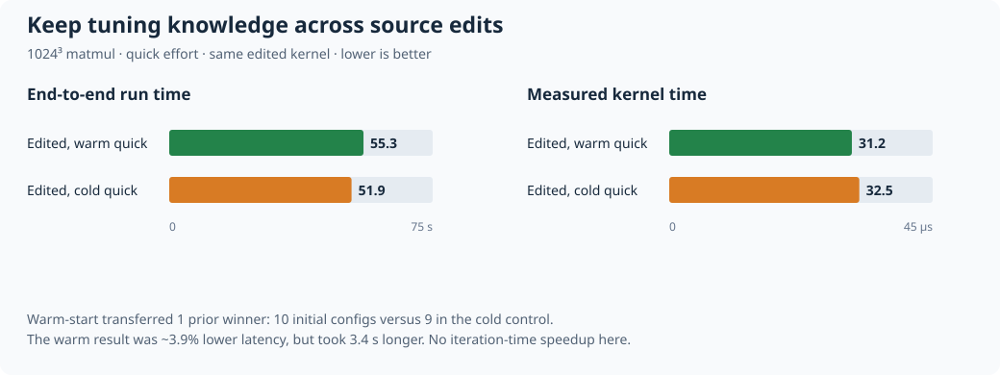
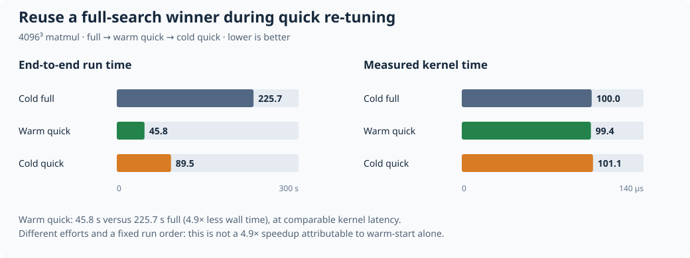

# Helion cache demos: keep tuning knowledge while you iterate

**Edit a kernel without throwing away its previous tuning work.**
`from_best_available` starts a new autotuning search with compatible cached
winners. A remote cache makes that knowledge available beyond one local cache.

| Situation | What the cache does |
|---|---|
| Same kernel and exact cache key | Reuses the winner; skips autotuning |
| Kernel-body edit, compatible specialization and config space | `from_best_available` seeds a new search with earlier winners |
| Empty local cache, shared backend | Remote exact hit skips tuning, or remote `list()` supplies warm-start candidates |

The main use case is **developer iteration**, not a promise that every re-tune
is faster or every cached configuration is optimal. Warm-start still benchmarks
and searches; changing the hardware, specialization, or config space can prevent
transfer.

## 1. Developer iteration: the source changed, the tuning knowledge survived

[`case1_source_edit_warmstart.py`](case1_source_edit_warmstart.py) tunes a matmul,
changes its **kernel body** to compute `2 * (x @ y)`, then compares warm and cold
quick searches on that same edited kernel. The edit preserves the tiling skeleton.

| 1024³ matmul | Run wall time ↓ | Measured kernel time ↓ | Initial population |
|---|---:|---:|---|
| Before edit, cold quick | 46.7 s | 0.0321 ms | No prior cached winner |
| **After edit, warm quick** | **55.3 s** | **0.0312 ms** | **9 seed/default + 1 cached** |
| After edit, cold quick | 51.9 s | 0.0325 ms | 9 seed/default |



**What this proves:** the edited kernel missed the exact cache but transferred
the earlier winner into its new search. The measured warm result had ~3.9% lower
kernel latency than the cold control. It did **not** save wall time in this run:
55.3 s versus 51.9 s. The transferable knowledge, rather than a guaranteed
speedup on every small edit, is the important result.

Actual warm-run log lines:

```text
[0s] Found 1 cached config(s) from previous runs
[0s] Seed/default/cache population: 10 total
[1s] Qualified population of 10, 2 retained search paths:
```

The log also records `Cached config 1 (transferred): Config(...)`; there is no
`Using cached config:` exact hit. The cold control starts with 9 configs and no
cached transfer. Both outputs are checked against the edited torch reference.

## 2. Why keep a good winner? Quick re-tuning at full-search quality

[`compare_full_then_quick.py`](compare_full_then_quick.py) first invests in a full
search, then compares quick re-tuning with and without its cached winner.
This comparison uses an **unchanged** kernel; section 1 demonstrates source edits.

| 4096³ matmul | Run wall time ↓ | Measured kernel time ↓ | Initial population |
|---|---:|---:|---:|
| Cold full (`from_random`) | 225.7 s | 0.1000 ms | 100 |
| **Warm quick (`from_best_available`)** | **45.8 s** | **0.0994 ms** | **10** |
| Cold quick (no cached winner) | 89.5 s | 0.1011 ms | 9 |



The warm quick run took **4.9× less wall time than full**, with comparable kernel
latency. Against cold quick, it took **1.95× less wall time** in this run.
That makes a useful development workflow: invest in a good winner, reuse it
while editing, and run a deeper search when ready.

These are single observations, not statistical guarantees. Full versus quick
changes the search effort as well as cache availability. The fixed order
(full → warm quick → cold quick), compilation-cache reuse, and GPU state can
affect wall time; the 4.9× difference is **not attributable to warm-start alone**.

## 3. Remote cache: share the result, not another tuning job

[`case5_remote_cache_backend.py`](case5_remote_cache_backend.py) uses the small
[`FileBackend`](demo_remote_backend.py) implementation of `RemoteCacheBackend`.
Separate empty local directories simulate workers sharing `remote_store/`.

| Worker / scenario | Observed result |
|---|---|
| A: quick-tune with `RemoteAutotuneCache` | 1 local entry and 1 shared entry written |
| B: empty local cache, same kernel | Remote exact hit; skips autotuning; materializes 1 local entry |
| B′: backend disabled | Exact hit on B's materialized local entry; no autotuning |
| C: edited kernel, default `LocalAutotuneCache` | Exact miss; **1 remote winner transferred through `list()`** |
| D: backend raises connection errors | Full search completes and writes a local entry; read/write warnings recorded |
| Corrupt shared JSON | Invalid entry skipped; valid remote winner still transferred |

**Value:** B does not repeat A's search, and C can reuse A's tuning knowledge
even after a source edit. No remote wall-time speedup was measured here.
This is a directory-backed protocol demo, not a network/storage-service benchmark.
Workers are simulated **in one process**, resetting the kernel between calls:
the measured Helion snapshot's default callable argument has a process-sensitive
exact-match key. This does not establish cross-host exact-match portability.

The two remote modes are independent:

```bash
# Exact-match read-through/write-through AND remote warm-start candidates:
export HELION_AUTOTUNE_CACHE=RemoteAutotuneCache
export HELION_REMOTE_CACHE_BACKEND=demo_remote_backend.FileBackend
export HELION_DEMO_REMOTE_DIR="$PWD/remote_store"

# Only remote warm-start candidates (keep the default local exact cache):
unset HELION_AUTOTUNE_CACHE
# Leave HELION_REMOTE_CACHE_BACKEND and HELION_DEMO_REMOTE_DIR set.
```

A real service would implement `get(key)`, `put(key, data)`, and `list()` with its
own storage and operational safeguards. This demo needs no credentials or service.

## Reproduce on a CUDA GPU

### Install

Use Linux, an NVIDIA CUDA GPU, and a compatible Helion checkout containing
`from_best_available`, `RemoteCacheBackend`, and `RemoteAutotuneCache`.
No runtime imports depend on the original demo directory or Helion's examples.

```bash
# From this directory. Install uv first if needed: https://docs.astral.sh/uv/
uv venv --python 3.12
source .venv/bin/activate
uv pip install "torch==2.13.*" --index-url https://download.pytorch.org/whl/cu130
uv pip install setuptools ninja

# Set this to your compatible Helion source checkout, wherever it lives.
export HELION_SRC=/absolute/path/to/helion
SETUPTOOLS_SCM_PRETEND_VERSION=0.0.0 uv pip install -e "${HELION_SRC}[dev]"

nvidia-smi
export DEMO_CUDA_VISIBLE_DEVICES=0   # choose an idle GPU
CUDA_VISIBLE_DEVICES="$DEMO_CUDA_VISIBLE_DEVICES" python -c \
  'import torch, helion, triton; from helion.autotuner.remote_cache import RemoteCacheBackend, RemoteAutotuneCache; assert torch.cuda.is_available(); print(torch.cuda.get_device_name(0), torch.__version__, triton.__version__, helion.__file__)'
```

The cu130 wheel requires a compatible driver; use a different PyTorch CUDA index
if needed. Its Linux wheel supplies Triton. Compiler headers matching Python
(for example `python3.12-dev`) may also be needed by Triton.

### Run the main demos

```bash
python case1_source_edit_warmstart.py   # main developer-iteration experiment
python case5_remote_cache_backend.py   # exact sharing, remote warm-start, outage
python compare_full_then_quick.py      # 4096³, uncapped full search; takes minutes
```

Each command prints a verdict and saves detailed logs. `HELION_FORCE_AUTOTUNE=1`
is explicitly set for the comparison's warm quick step so that it **re-tunes**
instead of silently taking an exact hit on revisions with stable keys.

For all included experiments, with console results saved under `results/latest/`:

```bash
python run_all.py
```

The scripts use these shared settings:

```bash
HELION_AUTOTUNER=LFBOPatternSearch
HELION_AUTOTUNE_LOG_LEVEL=DEBUG
HELION_LOGS=+all
```

They select the non-LLM search for a self-contained experiment and expose transfer
logs. Ambient `HELION_*` flags are cleared in child processes; each step explicitly
sets its own isolated `HELION_CACHE_DIR` and effort. GPU selection uses
`DEMO_CUDA_VISIBLE_DEVICES`, then `CUDA_VISIBLE_DEVICES`, then device `0`.

| Experiment | Step-specific settings |
|---|---|
| Source edit | `HELION_AUTOTUNE_EFFORT=quick`; same cache before/after edit, fresh cache for control |
| Full → quick | Cold `full` + `from_random`; warm `quick` + force + `from_best_available`; fresh-cache `quick` control; no budget cap |
| Remote | Backend/cache-class settings above; `quick` for A/B/B′/C, `full` for outage; local-only cache for C |
| Effort escalation | `full` + force + 120 s budget; warm `from_best_available`, cold `from_random` |
| Slow-cache resilience | `quick` tune and exact hit; forced `full` + `from_best_available`, no budget cap |

Runs regenerate their own demo cache entries, overwrite their named logs, and
temporarily edit **only** `kernels/matmul_demo.py`, restoring it in `finally`.
Run the scripts sequentially in a writable directory. Do not put valuable cache
entries in these demo directories.

### Use the workflow in your own development

```bash
export HELION_CACHE_DIR="$PWD/my_dev_cache"
export HELION_AUTOTUNER=LFBOPatternSearch

# Tune, edit the kernel body, run again. Compatible cached winners seed the search.
HELION_AUTOTUNE_EFFORT=quick python your_kernel.py

# Before concluding: re-search from prior winners plus random candidates.
HELION_FORCE_AUTOTUNE=1 HELION_AUTOTUNE_EFFORT=full \
  HELION_AUTOTUNER_INITIAL_POPULATION=from_best_available \
  HELION_AUTOTUNE_BUDGET_SECONDS=120 python your_kernel.py
```

Change a line **inside the kernel function**, not just a module-level constant:
the source hash used by this exact cache covers the function's source. Force
autotuning to re-search an unchanged kernel; it preserves warm-start candidates.
`HELION_SKIP_CACHE=1` instead disables cache reads and writes.

## Optional: deeper search and a bad cached candidate

These support the main workflow; they are not required for the first two demos.

```bash
python case2_effort_escalation.py
python case4_poisoned_entry_resilience.py
```

| Experiment | Control | Warm-started result | Takeaway |
|---|---|---|---|
| Quick → full, 1024³, 120 s tuning budget | Cold full: 83.8 s / 0.0310 ms | Warm full: 88.9 s / 0.0319 ms | Cached winner transferred; population grows 10 → 100. No measured speedup; latency within the script's 5% tolerance. |
| Deliberately slow cache, 4096³ | Original winner 0.1046 ms; slow exact hit **0.2659 ms** | Forced warm full **0.1010 ms** (198.2 s) | A slow seed was benchmarked and lost; a good winner was written. |

A cached candidate is not guaranteed to win a new search. Conversely, an exact
hit trusts the cached config without re-timing it. In the slow-cache experiment
the re-tune may write a **new entry**, leaving the old entry in place when its
exact key differs; this is not a claim of universal in-place cache repair.

## Measurements and portable files

Published measurements come from NVIDIA **B200**, CUDA 13.0, driver 580.173.02,
Python 3.12, torch 2.13.0+cu130, and a source-installed Helion snapshot with
`LFBOPatternSearch`. The original artifacts did not record a Helion commit or
exact Triton version, so bit-for-bit reproduction is not promised. These are
recorded GPU results, **not new measurements on the machine preparing this repo**.
The packaging changes (explicit force flag, stronger per-worker checks, and
metadata capture) have been checked locally but have not been re-run on CUDA here.

Wall time is the whole child process (imports, compilation, autotuning,
correctness check, and measurement), not pure search time. Kernel time is the
mean steady-state CUDA-event time over repeated calls after a torch reference
check. Single runs have no confidence intervals; tolerances in the scripts are
acceptance thresholds, not measured noise estimates. Repeat on the same idle GPU
and examine logs rather than treating every small difference as significant.

The self-contained demo consists of:

```text
README.md
common.py / demo_remote_backend.py / run_all.py
case1_source_edit_warmstart.py / compare_full_then_quick.py
case5_remote_cache_backend.py
case2_effort_escalation.py / case4_poisoned_entry_resilience.py
kernels/       copied matmul + three drivers; no external example imports
results/       recorded_b200.json (published numbers); latest/ generated by runs
plot_results.py
plots/         two SVG charts embedded above
```

All paths resolve relative to these files. Copy these files/directories to move
the demo; generated caches, raw logs, virtual environments, and archives are not
needed. New runs create `cache/`, `remote_store/`, `remote_store_corrupt/`, and
`logs/`. Each log has a `.meta.json` sidecar with the command, explicit Helion
settings, GPU selection, return code, and wall time. Drivers emit `RESULT_JSON=`.
The remote driver includes each simulated worker's settings and cache-counter
delta in its JSON result.

Redraw the published plots without a GPU or additional dependencies:

```bash
python plot_results.py
```

**Quick to iterate. Full + force to conclude. Remote to share.**
